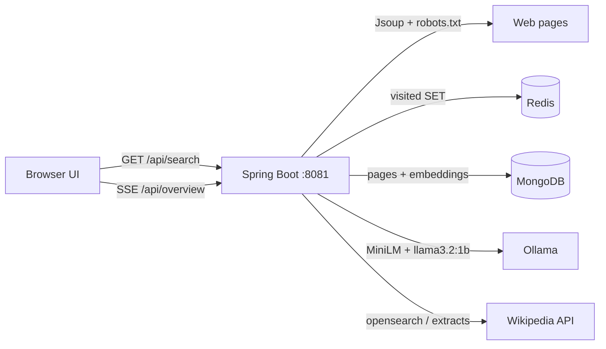

<p align="center">
  
</p>

<h1 align="center">
  <span style="color:#4285F4">C</span><span style="color:#EA4335">r</span><span style="color:#FBBC05">a</span><span style="color:#4285F4">w</span><span style="color:#34A853">l</span><span style="color:#EA4335">r</span>
</h1>

<p align="center"><b>Crawl. Index. Ask. Cite.</b></p>

<p align="center">
  A Google-style search UI backed by a <b>Java 17 / Spring Boot</b> pipeline:<br/>
  Jsoup crawler → Redis visited-set → Mongo pages + MiniLM vectors → local Ollama RAG.
</p>

<p align="center">
  
  
  
  
  
  
</p>

<p align="center">
  <a href="http://localhost:8081/"><strong>Open the UI → http://localhost:8081/</strong></a>
</p>

---

## What you get

| Surface | What it does |
| --- | --- |
| **Home** | Google-like landing page, lucky search, index count |
| **All** | Source links + snippets as soon as retrieval returns |
| **AI Mode** | Streaming overview from crawled text only (SSE) |
| **Live fetch** | If the local index has no *title-level* match, pull English Wikipedia for that topic |

> This is a **single-node demo**, not a Google-scale crawler. One JVM crawls and serves the API. Redis is a visited-URL set. Ranking is keyword overlap + in-memory cosine (not Atlas `$vectorSearch`).

---

## Architecture



**Hot path (fast):** rank Mongo → JSON links.  
**Slow path (background):** stream a 4-sentence overview from `llama3.2:1b`.

---

## Quick start

### Prerequisites

- Docker Desktop
- Java 17 + Maven (or `./mvnw`) to build the jar

### 1. Package

```bash
./mvnw clean package
```

Windows:

```powershell
.\mvnw.cmd clean package
```

### 2. Launch the stack

```bash
docker compose up --build
```

Compose waits for healthy Mongo + Redis, pulls `all-minilm` and `llama3.2:1b`, then starts the app. First boot can take several minutes while models download.

### 3. Search

| URL | Purpose |
| --- | --- |
| http://localhost:8081/ | UI |
| http://localhost:8081/api/status | Indexed count / Ollama models |
| http://localhost:8081/api/search?q=animals | Links only |
| http://localhost:8081/api/overview?q=animals | SSE tokens |
| http://localhost:8081/api/crawl?maxPages=20 | Recrawl seeds |

Wait until `/api/status` shows `indexed_documents` &gt; 0. A **new topic** may live-fetch Wikipedia on the first search; repeats hit Mongo.

Manual model pull (only if you run Ollama yourself):

```bash
docker exec -it crawler_ollama ollama pull all-minilm
docker exec -it crawler_ollama ollama pull llama3.2:1b
```

Stop:

```bash
docker compose down
```

---

## Run from the IDE

1. `docker compose up mongodb redis ollama ollama-init`
2. Run `DistributedCrawlerApplication` (Java 17)
3. Defaults: Mongo `localhost:27017/crawler_db`, Redis `localhost`, Ollama `http://localhost:11434`
4. UI: http://localhost:8081/

---

## API

`GET /api/search?q=...` — **no LLM wait**. `retrieval_ms` is in the payload.

```json
{
  "query": "tell me about animals",
  "status": "SUCCESS",
  "results_count": 4,
  "retrieval_ms": 900,
  "source_references": [
    {
      "title": "Animal - Wikipedia",
      "url": "https://en.wikipedia.org/wiki/Animal",
      "snippet": "Animals are multicellular eukaryotic organisms..."
    }
  ]
}
```

`GET /api/overview?q=...` — SSE: `event: token` with JSON `{"t":"..."}` (spaces preserved), then `event: done`.

---

## Tests

```bash
./mvnw test
```

- Distinctive terms / stop words
- Noisy titles (`(song)`, disambiguation, books)
- Off-topic ranking rejection
- Title-must-match the topic
- `robots.txt` Disallow prefixes
- Ingest upsert-by-URL when embeddings fail

---

## Honest limits

- One process, one crawl pool — not a worker fleet
- No Kafka; cosine is in-app over a few hundred docs
- Seed crawl is Wikipedia sleep/habit pages; other topics use Wikipedia fallback
- `llama3.2:1b` on Docker CPU is small and slow — that is why overview **streams after** links

## If this grew

- Frontier queue + many crawler workers
- Real vector index (pgvector / OpenSearch k-NN)
- GPU Ollama on the host for faster generation
- Better HTML boilerplate stripping
